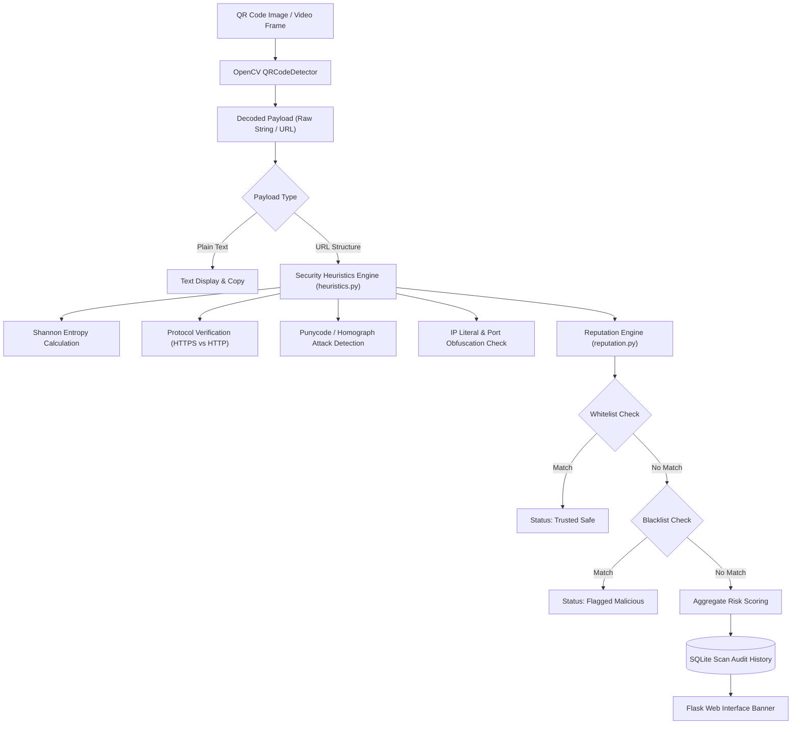

# Secure QR Reputation Analyzer & Malicious URL Detection Engine


A security utility designed to inspect, decode, and evaluate QR codes in real time. Beyond standard payload decoding, the system executes heuristic URL vulnerability checks (punycode, entropy, IP literal spoofing) and maintains an audited scan history.

---

## 🏛️ Pipeline Architecture



---

## 🔬 Core Features

- **Computer Vision QR Decoding:** Uses OpenCV's native `QRCodeDetector` for fast frame analysis.
- **Deep Heuristic Risk Scoring:**
  - Evaluates URL string Shannon entropy to catch obfuscated subdomains.
  - Detects Unicode homograph attacks and punycode strings (`xn--`).
  - Flags raw IP hostnames, non-standard web ports, and excessive subdomain nesting.
- **Reputation Filtering:** Verifies domains against local whitelist and known-malicious blacklist corpora.
- **Persistent Scan History:** Records every scan timestamp, URL payload, risk score, and verdict in SQLite.

---

## 📁 Repository Structure

```
Advance_QR_scanning_system/
├── app.py                     # Flask web server and API endpoints
├── heuristics.py              # URL security analysis and entropy scoring
├── reputation.py              # Whitelist/blacklist domain matching
├── QR_codes_generators.py     # Synthetic test QR generator
├── whitelist.txt              # Known trusted domains
├── blacklist.txt              # Known malicious domains
└── requirements.txt           # Python dependency specification
```

---

## 🚀 Quickstart

```bash
git clone https://github.com/sultanriaz/Advance_QR_scanning_system.git
cd Advance_QR_scanning_system
python -m venv venv
# Linux / macOS:
source venv/bin/activate
# Windows:
.\venv\Scripts\Activate.ps1

pip install -r requirements.txt
python app.py
```
Open [http://localhost:5000](http://localhost:5000) to scan and evaluate QR payloads.
